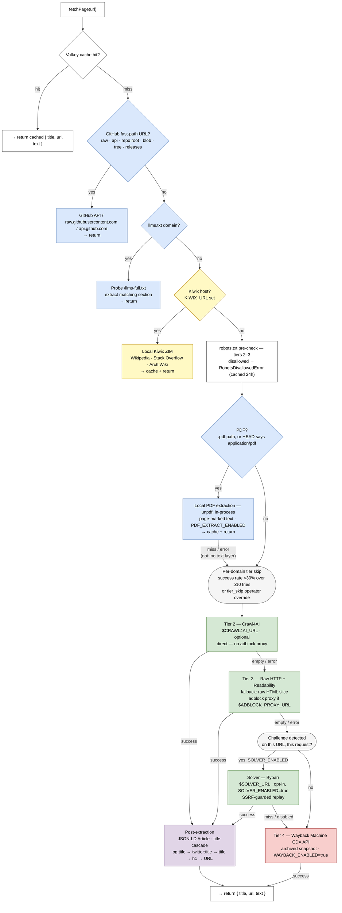

# private-search-4-agents

Private web search for AI agents, over MCP. Queries go to your own [SearXNG](https://github.com/searxng/searxng);
results are reranked by a local model; pages are fetched and extracted locally (fast paths, Crawl4AI,
then an in-process raw fetch) into markdown, PDFs included. No third-party search or scraping API sees what your agents look up.

Forked from [TadMSTR/searxng-mcp](https://github.com/TadMSTR/searxng-mcp) (MIT) at v3.30.1 and maintained
separately: Firecrawl is gone, and the tool surface is tuned for agent consumption — few tools, small
schemas, bounded and pageable output.

## Quick Start

**A running [SearXNG](https://github.com/searxng/searxng) instance is the only requirement.**
Everything else is optional and improves a specific dimension — see [Prerequisites](docs/configuration.md#prerequisites-and-service-setup).

**SearXNG only** — nothing else deployed:

```bash
SEARXNG_URL=http://localhost:8081 \
  CACHE_URL= RERANKER_URL= \
  node build/src/index.js
```

What works in this configuration: `search` returns results, and `fetch_url` (and `search` with
`content: "full"`) return page content as markdown via tier 3 (raw HTTP fetch + Readability,
wholly in-process), with PDFs extracted in-process too. What does not: semantic reranking
(results keep SearXNG's ordering, and `highlights` / `fetch_url` `query` passages fall back to
term overlap), query expansion and `search` `answer: true` (no LLM), caching (every call is live),
JS-heavy page rendering, and offline serving.

The startup capability line reports three states per capability, not two:
`on` (self-contained — nothing remote has to work for it to be true), `unverified` (configured,
but this process has never contacted the backend), and `off` (not configured). Nothing probes at
startup, so `unverified` is not a health failure — it's the honest absence of a health claim, not
an error. The command above prints exactly this:

```
capabilities on=tier3,pdf unverified=none off=tier2,cache,reranker,llm,kiwix,hister,solver,wayback,otel,nats
```

`tier3` and `pdf` are the only things `on`, because they are the only capabilities that are true
without anything remote working — both run in-process. `wayback` is `off` until you set `WAYBACK_ENABLED=true` — it is a feature flag,
not a default.

The two overrides are what make it a *clean* minimal run rather than merely a working one.
`CACHE_URL` and `RERANKER_URL` both have non-empty defaults, so left alone the server spends the
whole run talking to services that were never deployed. Neither has a kill switch, so the lever
is an empty string.

### The compose ladder

Four compose files in [`examples/`](examples/), each a strict superset of the one above it. Start
at the rung that matches what you are willing to run; every rung's header comment states what
works, what does not, and which environment variable moves you up.

| Rung | File | Adds | Containers | RAM | Unlocks |
|---|---|---|---|---|---|
| 1 | [`compose.minimal.yml`](examples/compose.minimal.yml) | SearXNG + this server | 2 | ~600 MB | The least you can run |
| 2 | [`compose.crawl4ai.yml`](examples/compose.crawl4ai.yml) | cache, Crawl4AI | 4 | ~6 GB | JS rendering, real caching |
| 3 | [`compose.reranker.yml`](examples/compose.reranker.yml) | reranker | 5 | ~8 GB | Relevance reranking, `min_score` |
| 4 | [`compose.full.yml`](examples/compose.full.yml) | Ollama, Kiwix, NATS, adblock | 9 | ~20 GB | Summarisation, offline corpora |

**Rung 2 is the recommended starting point** — the cache is the single largest latency win, and
Crawl4AI gets you JavaScript rendering for one container.

```bash
cd examples
export SEARXNG_SECRET=$(openssl rand -hex 32)
docker compose -f compose.crawl4ai.yml up -d
```

Moving up a rung is `docker compose -f compose.<next>.yml up -d` — all four share a compose
project name, so compose reconciles in place rather than starting a second copy of what you
already had.

**As a container** — this fork publishes no image; build the `Dockerfile`
(`docker build -t private-search-4-agents .`). The `ghcr.io/tadmstr/*` images referenced by
upstream docs and the compose examples are upstream's and carry the old tool surface — see
[Deployment](docs/deployment.md#container-image-upstream).

The reranker ships in this repo — `cd docker/reranker && docker compose up`, or pull `ghcr.io/tadmstr/searxng-mcp-reranker`. It is CPU-only, needs no API key, and has the model baked in so there is no cold start. See [`docker/reranker/README.md`](docker/reranker/README.md).

The adblock proxy is also published as an image, `ghcr.io/tadmstr/searxng-mcp-adblock-proxy` —
ad/tracker filtering for tier 3 (raw fetch). It is an **open forward proxy with no authentication**, so
loopback or a private network only — see [`docker/adblock-proxy/README.md`](docker/adblock-proxy/README.md)
for placement. Its filter lists are fetched at runtime from `ADBLOCK_FILTERS_URL` (defaulted to
EasyList + EasyPrivacy) and reloaded on a schedule.

For a full local topology including Crawl4AI, Ollama, Kiwix, the adblock proxy, and NATS, see rung 4 of the ladder above — [`examples/compose.full.yml`](examples/compose.full.yml).

## Why this server?

There are a number of SearXNG MCP servers. Most wrap the search endpoint and stop there. The
differentiators here are in what happens *after* the search:

| | private-search-4-agents | Typical SearXNG MCP server |
|---|---|---|
| SearXNG search | yes | yes |
| ML reranking of results | local cross-encoder, reorders by relevance — ships in [`docker/reranker/`](docker/reranker/) | SearXNG's own ordering |
| Full-page content retrieval | fetch cascade — Crawl4AI, in-process raw fetch + Readability → markdown (headings, code fences, links, tables), opt-in solver and Wayback | none, or a single raw fetch |
| Long pages | pageable windows with an `offset=` footer; `find` for literal matches; `query` for reranked passages | truncated, silently |
| PDF text | in-process extraction (`unpdf`), keyless — `.pdf` URLs and extensionless PDFs alike | none |
| Per-domain routing | domain capability database learns which tier works per domain and skips the ones that do not | none |
| Cited answers | `search` `answer: true` — local LLM (Ollama or OpenAI-compatible), citations back to source URLs, explicit fallback marker | none |
| Site crawling | `crawl_site` — sitemap-first, optional BFS, scoped to the start URL's path | none |
| Caching | persistent, shared across clients (Valkey/Redis) | in-process or none |
| Challenge handling | detection-gated solver tier, plus a Wayback fallback | none |
| Observability | OpenTelemetry traces and metrics, NATS events, structured logs | none |

**Only SearXNG is required.** Everything in the table above degrades gracefully: with nothing
else deployed, `fetch_url` still returns extracted content from the in-process tier 3, and the
startup capability line tells you exactly what's configured, what's configured but not yet
verified, and what's off — see [Quick Start](#quick-start) above.

## Tools

Three tools, ~1.8k tokens of schema, plus MCP server `instructions` describing the flow.

| Tool | What it does |
|------|--------------|
| `search` | SearXNG search with local reranking; up to 5 phrasings per call. `content`: `snippets` (default), `highlights` (the most relevant passages of the top pages) or `full`. `answer: true` adds a cited local-LLM synthesis; if it cannot be produced the response leads with a `--- summarization unavailable (<kind>: <detail>) ---` marker and carries the pages instead. `include_domains` / `exclude_domains`, `time_range`, `min_score`, `fresh`. |
| `fetch_url` | Read up to 5 public URLs as markdown — HTML, PDF, GitHub API, YouTube transcripts, Reddit threads. Returns a window with a footer saying how to continue (`offset=`), or `query` passages, or `find` matches. |
| `crawl_site` | Crawl a site and return a URL/title/snippet manifest. Page content is cached, so follow-up `fetch_url` calls are free. |

`clear_cache` and `domain_stats` are operator tools, registered only with
`SEARXNG_MCP_ADMIN_TOOLS=true`. `search_and_fetch` and `search_and_summarize` were removed in
4.0.0 (use `search` with `content: "full"` / `answer: true`).

Full parameter reference: [`docs/tools.md`](docs/tools.md).

## Resources

Two read-only MCP Resources, additive to the tools above.

| URI | What it returns |
|-----|-----------------|
| `config://searxng-mcp` | Effective configuration and capability state — which backing services are wired, the three-state capability line, behaviour switches and tunables, and which credentials are configured. |
| `stats://domains` | Aggregate view of the domain capability database, mirroring the aggregate mode of the admin `domain_stats` tool. Reports `available: false` with a reason when the database cannot be read, which is **not** the same as it being empty. |

`config://searxng-mcp` never includes a credential value. Secrets are reported as a
boolean — configured or not — and every URL is stripped of inline userinfo before it is
emitted, because Basic Auth in `SEARXNG_URL` and an inline password in `CACHE_URL` are both
supported. The payload is built from an allowlist rather than by dumping config and removing
known secrets, so a newly-added field cannot leak by default.

**If you're behind an MCP proxy rather than talking to this server directly, verify it forwards
`resources/*`.** Many proxies re-register upstream tools on their own server instead of
forwarding the wire protocol generically, and drop Resources silently as a result — the tools
still work, only the Resources go missing. See
[Deployment](docs/deployment.md#mcp-resources-through-a-proxy) for a worked example of checking
this.

## Architecture

The fetch cascade, in full. Each stage is optional and skipped cleanly when unconfigured.

The `llms.txt` fast path (`llms` → `llms_fetch` below) matches against the host currently
allowlisted in `domains.json` — `platform.claude.com` — and extracts each page's section from
the document's `url:` front-matter (lowercase, YAML-style).



Read the rest — tier semantics, the domain capability database, adblocking, every fast path,
resilience and observability — in [`docs/architecture.md`](docs/architecture.md).

## Documentation

| | |
|---|---|
| [Configuration](docs/configuration.md) | Every environment variable, and setup for each optional backing service. |
| [Tools](docs/tools.md) | Full per-tool parameter reference. |
| [Deployment](docs/deployment.md) | Install, transports, HTTP auth, and MCP client recipes. |
| [Architecture](docs/architecture.md) | Fetch cascade, tier semantics, domain capability database. |
| [Security](docs/security.md) | SSRF, redirects, transport exposure, bounded reads, credentials. |

Index: [`docs/index.md`](docs/index.md).

## Contributing

See [CONTRIBUTING.md](CONTRIBUTING.md) for setup instructions, commit conventions, and the PR process.

### Integration tests

A real-Valkey integration suite covering domain-DB concurrency is gated on `VALKEY_TEST_URL` and skipped entirely when it's unset, so a plain `pnpm test` still works with no Valkey present:

```bash
VALKEY_TEST_URL=redis://:<password>@<host>:<port>/<scratch-db> pnpm test
```

Use a **scratch database index** — the suite writes and deletes `domain:*` keys and refuses to run against index `0` or `1` as a safety guard.

## License

MIT
